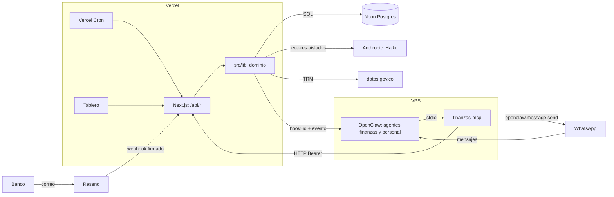
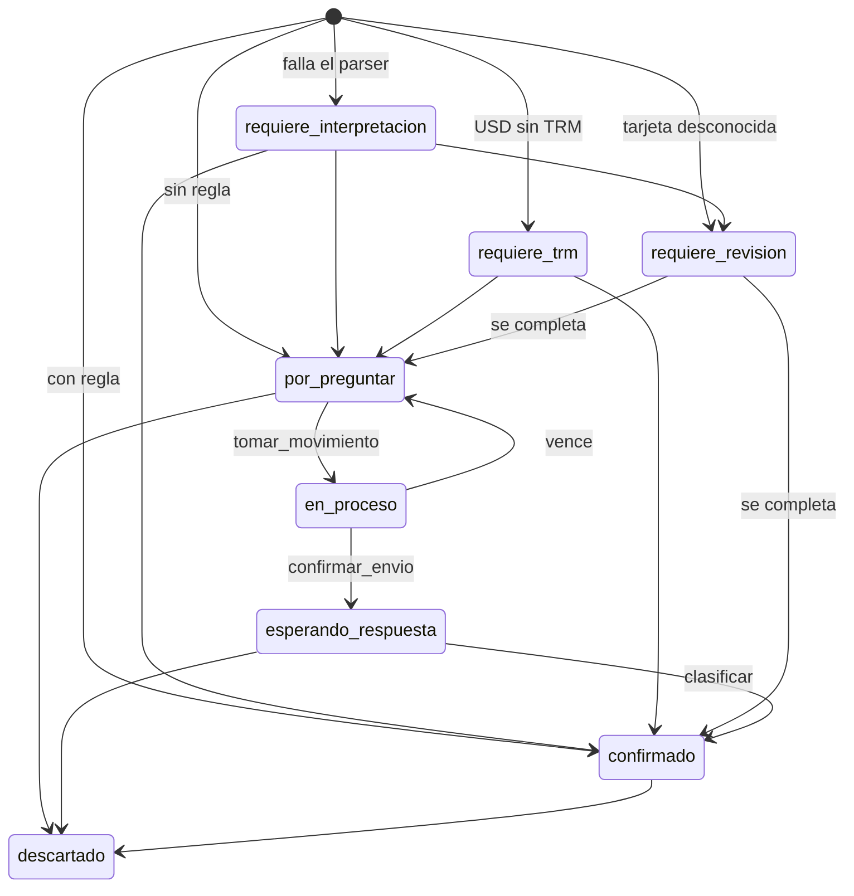

# Kairos Finanzas

Agente de gastos del hogar. Registra cada compra con tarjeta a partir de las alertas del banco, pregunta por WhatsApp de qué fue, concilia contra los extractos y muestra todo en un tablero web.

El modelo de lenguaje conversa; el servidor decide. Las cifras, los estados, los destinos de los mensajes y las validaciones viven en código determinista y en Postgres.

> Repositorio privado. Este README tiene todo el detalle técnico. Para compartir fuera del equipo, usa [`docs/presentacion-publica.md`](docs/presentacion-publica.md).

## Estado

| | |
|---|---|
| Producción | Vercel (Next.js 15) + Neon (Postgres) + agentes en un VPS con OpenClaw |
| Pruebas | 276: 275 pasan y 1 se omite (`pg-real`, requiere `PG_URL`) |
| Última revisión técnica | 8 nov 2026: documento interno |
| Riesgos abiertos | Ver [Límites y riesgos conocidos](#límites-y-riesgos-conocidos) |

La plataforma inicial, Volcano, ya no se usa. Solo quedan notas históricas en `docs/`.

## Qué hace

| Capacidad | Cómo funciona |
|---|---|
| Captura por correo | Las alertas del banco llegan por webhook, se interpretan y se convierten en movimientos |
| Clasificación | Reglas por comercio; si no hay regla, pregunta por WhatsApp con opciones numeradas |
| Compras en dólares | Convierte a COP con la TRM del día, y reintenta si aún no está publicada |
| Extractos | Lee el PDF, valida contra el total y concilia uno a uno, sin contar doble |
| Capturas y reportes | Foto, PDF, Excel o CSV de la app del banco: dice qué falta y lo carga si alguien lo autoriza |
| Tablero web | Resumen, detalle del mes, comparación, reclasificación, movimientos editables y bandeja «Por atender» |
| Recordatorios | Insiste a las 4 horas si una pregunta sigue sin respuesta |
| Resumen y repaso | Resumen diario y repaso dominical con confirmación en lote |
| Avisos de corte | Pide el extracto el día de corte de cada tarjeta |

## Arquitectura



| Componente | Dónde corre | Código |
|---|---|---|
| Tablero y 27 rutas (`runtime nodejs`) | Vercel, raíz `web/` | `web/`, importa `../src` con el alias `@src` |
| Lógica de dominio | Dentro de las funciones de Vercel | `src/lib/*`, envoltorios en `src/functions/*` |
| Adaptador petición → evento | Vercel | `web/lib/rutas.ts` |
| Base de datos | Neon, `pg` con pool de 2 conexiones | `src/lib/db.ts` |
| MCP `finanzas-mcp` (stdio) | Contenedor de OpenClaw en el VPS | `mcp/servidor.ts` |
| Reglas de los agentes | OpenClaw | Copias en `openclaw/` |

**Modelos**

| Uso | Modelo |
|---|---|
| Lectores de correo, extracto y captura | `claude-haiku-5-5` por API, sin herramientas reales y con salida forzada |
| Turnos automáticos del hook | Haiku, `thinking: off` (`OPENCLAW_HOOK_MODEL` lo cambia) |
| Agente `finanzas` (grupo) | Sonnet 5.5, configurado en OpenClaw |
| Agente `personal` (chats privados) | Haiku, configurado en OpenClaw |

## Principios de diseño

1. **El servidor decide.** El modelo pide acciones por herramientas con esquema estricto. Los destinos, los textos de las preguntas y las cifras los arma el servidor.
2. **Lectores en cuarentena.** Correos, extractos y capturas se leen en una llamada aislada a Haiku, sin herramientas reales y con salida forzada. Nada se usa antes de pasar validación determinista.
3. **El hook no lleva contenido.** Vercel avisa a OpenClaw solo con `movimiento_id` y evento.
4. **Idempotencia en todas las entradas.** `correo_id` en correos, `operacion_id` en escrituras del MCP, huella sha256 en extractos y archivos.
5. **Sin reenvíos a ciegas.** Si falla la confirmación de un envío, el MCP repite la confirmación, nunca el mensaje.
6. **Una compra suma una vez.** `idsQueNoSuman` es la regla única para tablero y resumen.
7. **Trazabilidad.** La tabla `bitacora` guarda quién cambió qué, con antes y después.

Estos principios tienen excepciones hoy; están en [Límites y riesgos conocidos](#límites-y-riesgos-conocidos).

## Flujos

### Correo a movimiento

`POST /api/correo` → `ingresarCorreo` (`src/lib/dominio.ts`)

1. Verifica la firma Svix sobre el cuerpo crudo. Solo procesa `email.received`.
2. Aplica idempotencia por `correo_id`.
3. Interpreta con el parser determinista del banco (`src/lib/parser.ts`). Si falla, usa el extractor en cuarentena (`src/lib/extractor.ts`, máximo 2 intentos).
4. Un reverso o rechazo con pareja (misma tarjeta, moneda, valor y comercio, 7 días) descarta la compra.
5. En USD calcula COP con la TRM. Sin TRM queda `requiere_trm`.
6. Con regla confirmada o comercio verificado y persona conocida, queda `confirmado`. Si no, `por_preguntar` y aviso al hook.

### Pregunta y respuesta

1. El agente llama `tomar_movimiento` (arrendamiento de 10 minutos) y `preguntar`.
2. El servidor arma el texto con opciones y un código (`#K7`) y decide el destino. El MCP envía y confirma con `confirmar_envio`.
3. La respuesta llega a `clasificar`, que acepta número, nombre o texto. `src/lib/referencias.ts` resuelve a qué compra se refiere; si es ambigua, devuelve opciones.
4. Las reglas de comercio nacen `propuesta` y se confirman con 2 coincidencias humanas. Una contradicción las reinicia. Los comercios genéricos nunca tienen regla.

### Extractos

Botón «Cargar extracto» → `POST /api/tablero/extracto` → `procesarExtracto` (`src/lib/extracto.ts`)

- Valida la suma contra el total, con tolerancia de 1 peso. Si no cuadra, queda `en_revision` y no concilia.
- Concilia uno a uno: misma tarjeta, mismo valor, ±3 días (`src/lib/conciliacion.ts`). Detalle en [`docs/conciliacion.md`](docs/conciliacion.md).
- El PDF no se guarda, solo su huella.
- Vercel corta el cuerpo en ~4,5 MB, aunque `MAX_PDF_BYTES` diga 8 MB.

### Capturas y reportes

`revisar_captura` y `cargar_faltantes` (`src/lib/captura.ts`). Diseño en [`docs/plan-capturas.md`](docs/plan-capturas.md).

- El MCP lee el adjunto con guardas: solo carpetas de adjuntos de OpenClaw, jpg, png, webp, pdf, xlsx o csv, máximo 3,3 MB.
- Excel y CSV se leen sin modelo, con detección de encabezados. Imagen y PDF van a Haiku.
- Cada línea queda en `ya_cargada`, `falta`, `dudosa`, `ignorada` o `revision`.
- Solo se carga tras un «sí» explícito. Una autorización en lote no crea reglas de comercio.

### Tablero

`web/app/page.tsx`, interfaz en `web/lib/explorador/app.ts` (DOM + d3).

Vistas: Resumen, Detalle del mes, Comparar, Reclasificar y Movimientos. El filtro de mes empieza en el mes actual, en hora de Bogotá.

Acciones: reclasificar, editar los datos de una compra, confirmar, completar o descartar compras en revisión, crear categorías, resolver envíos sin confirmar, ver el mensaje original y cargar extractos.

### Tareas programadas

| Tarea | Frecuencia | Dónde |
|---|---|---|
| Recordatorios | Cada 15 min | Vercel Cron → `/api/cron/recordatorios` |
| Respaldo: arrendamientos vencidos, TRM y extractor pendientes, re-avisos, avisos de corte, purga de `operaciones` | Cada 30 min | Vercel Cron → `/api/cron/respaldo` |
| Resumen diario | 8 p. m. | Cron de OpenClaw |
| Repaso dominical | Domingo, 8 p. m. | Cron de OpenClaw |

Vercel Cron autentica con `Bearer CRON_SECRET`; sin esa variable, las rutas responden 503.

## Modelo de datos

Fuente: `db/esquema.sql`, `db/semilla.sql` y `db/cambios.sql`. Son 19 tablas, sin RLS: solo el servidor accede.

| Tabla | Para qué |
|---|---|
| `movimientos` | Cada compra: estado, valor, moneda y TRM, cuotas, tarjeta, persona, categoría, fuente, pregunta y conciliación |
| `correos` | Correo recibido e interpretación |
| `tarjetas` | Tipo, últimos 4, persona por defecto, día de corte |
| `categorias` | `activa`, `propuesta` o `inactiva` |
| `comercios`, `comercios_genericos` | Comercios con patrones y pasarelas que nunca reciben regla |
| `reglas_comercio` | Regla por comercio y su ciclo de vida |
| `config` | Modo de preguntas, umbrales y destinos |
| `bitacora` | Auditoría con antes y después |
| `tokens_reclasificacion` | Tokens de un solo uso |
| `trm` | Caché de TRM por fecha |
| `tablero_intentos` | Fallos de ingreso para el bloqueo |
| `recordatorios_pendientes` | Cola de recordatorios |
| `operaciones` | Idempotencia del MCP |
| `avisos_corte` | Un aviso por tarjeta y mes |
| `extractos`, `conciliaciones` | Extracto leído y resultado por línea |
| `revisiones_captura`, `revisiones_captura_lineas` | Archivo revisado y resultado por línea |

Estados de un movimiento:



`provisional` existe en el `CHECK`, pero ningún código lo asigna.

## Interfaces

### Herramientas MCP

Autenticación MCP → Vercel: `Authorization: Bearer`. Validación Zod estricta en ambos lados. Cuerpo: `{ entrada, contexto, operacion_id? }`.

| Herramienta | Qué hace | Envía por WhatsApp |
|---|---|---|
| `tomar_movimiento` | Toma atómica con arrendamiento | |
| `preguntar` | Prepara la pregunta | Sí |
| `recordar` | Prepara el recordatorio | Sí |
| `pendientes` | Lista lo que falta por responder | |
| `resolver_respuesta` | Determina a qué compra corresponde | |
| `reasignar_pregunta` | Pasa la pregunta a la otra persona | Sí |
| `clasificar` | Registra la categoría | |
| `cambiar_cuotas` | Cuotas de 1 a 48 | |
| `descartar_movimiento` | Descarta con motivo | |
| `proponer_regla`, `proponer_categoria` | Propuestas | |
| `reclasificar` | Dos fases con token | |
| `resumen`, `repaso` | Cifras calculadas en SQL | |
| `confirmar_repaso` | Confirma en lote | |
| `modo_preguntas` | `por_comercio` o `siempre` | |
| `enviar_detalle` | Mensaje original de la compra | Sí |
| `aviso_corte` | Aviso de corte | Sí |
| `revisar_captura`, `cargar_faltantes` | Capturas y reportes | |

Solo HTTP, las llama el MCP: `confirmar_envio` y `confirmar_recordatorio`. Cada herramienta se publica en `POST /api/<nombre-con-guiones>`.

### Otras rutas

| Ruta | Método | Autenticación |
|---|---|---|
| `/api/correo` | POST | Firma Svix |
| `/api/respaldo` | POST | `Bearer FINANZAS_API_TOKEN` (heredada) |
| `/api/cron/respaldo`, `/api/cron/recordatorios` | GET | `Bearer CRON_SECRET` |

### API del tablero: `/api/tablero/*`

Todas exigen mismo origen (`Origin`, `Sec-Fetch-Site`). Salvo `/login` y `/logout`, requieren la cookie de sesión `__Host-tablero_sesion`.

| Ruta | Método | Función |
|---|---|---|
| `/sesion` | GET | Sesión actual |
| `/login` | POST | Ingreso, con bloqueo por intentos |
| `/logout` | POST | Cierra sesión |
| `/explorador/datos` | GET | Datos del tablero |
| `/explorador/reclasificar` | POST | Por movimiento, comercio o lote |
| `/datos?mes=` | GET | Vista anterior, conservada |
| `/detalle?id=` | GET | Compra con su mensaje original |
| `/extracto` | POST | PDF en base64 |
| `/envio` | POST | `si_llego` o `volver_a_preguntar` |
| `/categorias` | POST | Crea una categoría |
| `/revision` | POST | `completar` o `descartar` |
| `/confirmar` | POST | Confirma con categoría |
| `/fecha` | POST | Cambia la fecha |
| `/editar` | POST | Edita los datos de una compra |

## Variables de entorno

Solo nombres. Los valores nunca se versionan.

| Dónde | Variables |
|---|---|
| Vercel, requeridas | `KAIROS_AGENT_DATABASE_URL` (o `DATABASE_URL`, que tiene prioridad), `FINANZAS_API_TOKEN`, `CRON_SECRET`, `RESEND_WEBHOOK_SECRET`, `RESEND_API_KEY`, `ANTHROPIC_API_KEY`, `OPENCLAW_HOOK_URL`, `OPENCLAW_HOOK_TOKEN`, `TABLERO_CORREOS`, `TABLERO_CODIGO` (6 a 32 letras o dígitos; conviene 12 o más), `TABLERO_SESION_SECRET`, `TABLERO_PERSONAS` (correo=miguel o katerine; sin esto no hay sesión) |
| Vercel, opcionales | `DATABASE_POOL_MAX`, `OPENCLAW_HOOK_MODEL` |
| MCP en el VPS | `FINANZAS_API_TOKEN_FILE` (o `FINANZAS_API_TOKEN`), `FINANZAS_URLS_FILE`, `FINANZAS_URL_PLANTILLA`, `FINANZAS_MODELO`, `FINANZAS_MEDIA_DIR`, `FINANZAS_WHATSAPP_ACCOUNT`, `OPENCLAW_BIN` |
| Local y pruebas | `NEXT_PUBLIC_TABLERO_DEMO`, `PG_URL` |

## Desarrollo

```bash
npm install
npm test
npm run typecheck
npm run build:mcp
```

Las pruebas usan PGlite (Postgres en proceso) y datos sintéticos. Para ver el tablero con datos de ejemplo:

```bash
cd web && npm install && NEXT_PUBLIC_TABLERO_DEMO=1 npm run dev
```

Abre `http://localhost:3100`.

| Comando | Qué hace |
|---|---|
| `npm run migraciones` | Regenera `db/migrations/` desde `db/*.sql`. No aplica nada a ninguna base |
| `npm run build` | `migraciones` + `build:mcp` |
| `node scripts/generar-rutas-next.mjs` | Regenera `web/app/api/*/route.ts` desde `src/functions/` |
| `node scripts/reglas-finanzas.mjs [--check] <AGENTS.md>` | Copia o verifica el bloque de reglas del agente |

### Estructura

```
db/             Esquema, semilla, cambios y migraciones generadas
docs/           Diseño, conciliación, planes y revisión técnica
mcp/            Servidor MCP
openclaw/       Reglas de los agentes
scripts/        Generadores
src/lib/        Lógica de dominio
src/functions/  Envoltorios por ruta
test/           Pruebas y datos sintéticos
web/            Next.js: tablero y rutas
```

### Agregar una migración

1. Añade el bloque `-- @@ nombre` **al final** de `db/cambios.sql`. La numeración depende del orden.
2. Corre `npm run migraciones`.
3. Aplícala a mano antes de desplegar el código que la necesita.

## Despliegue

**Web.** Un push a `main` despliega en Vercel.

**Migraciones.** No hay ejecutor automático. Se aplican con `psql` contra la conexión directa de Neon. El archivo `neon.env` es local y no se versiona; se genera con `cd web && vercel env pull ../neon.env --environment=production`.

```bash
URL=$(grep '^KAIROS_AGENT_DATABASE_URL_UNPOOLED=' neon.env | cut -d= -f2- | tr -d '"')
psql "$URL" -1 -v ON_ERROR_STOP=1 -f db/migrations/NNN_nombre.sql
```

**MCP.** Sale de `npm run build:mcp`. Hay que respaldar el archivo anterior, copiar `mcp/dist/finanzas-mcp.cjs` a `/root/.openclaw/tools/finanzas/`, reiniciar el gateway con pm2 y comprobar que quede un solo proceso.

**Reglas del agente.** Aplica `scripts/reglas-finanzas.mjs` sobre el `AGENTS.md` de cada agente, con respaldo. Mantén cada archivo por debajo de 10.000 bytes. Solo las sesiones nuevas toman los cambios: hay que enviar `/new`.

El orden seguro es: migración, web, MCP, reglas, `/new`.

## Límites y riesgos conocidos

Detalle, evidencia y arreglos en documento interno. Estado al cierre de la revisión (2026-11-08): cerrados con prueba los marcados como ✅; abiertos los demás.

**Seguridad**

| ID | Estado | Riesgo o pendiente |
|---|---|---|
| SEC-001 | ✅ | El asunto de un correo externo ya no entra a la compra ni llega al modelo por `resumen`/`repaso`. Queda `exec` disponible en `personal` (contención pendiente de decisión) |
| SEC-002 | ✅ parcial | El remitente debe venir del dominio del banco. **Plata Pay sigue validándose solo por nombre**: falta confirmar su dominio real |
| SEC-003 | ✅ | El comercio por regex pasa la misma validación que el extractor |
| SEC-004 | Abierto | La identidad y las aprobaciones las declara el modelo. Requiere confirmar de qué canal llega el remitente (`_meta`) |
| SEC-005 | ✅ parcial | Bloqueo atómico (el intento se reserva antes de verificar). El código acepta 6 a 32 caracteres: **conviene subirlo a 12 o más**. Un TOTP o enlace mágico por persona queda como mejora |
| SEC-006 | ✅ | `preguntar` ignora el texto del modelo; el servidor arma la pregunta |
| SEC-007 | ✅ | Topes de valor COP (1.000 millones) y USD (50.000) |
| SEC-008 | ✅ | Entradas recortadas antes de procesar |
| SEC-009 | ✅ | El bloqueo es por par correo+IP y por IP; un tercero no bloquea a la persona autorizada |
| SEC-010 | ✅ | Cerrar sesión revoca las sesiones del correo |
| SEC-011 | ✅ | Los adjuntos solo se aceptan de `finanzas` y `personal` |
| SEC-012 | ✅ | Sin persona asignada en `TABLERO_PERSONAS` no hay sesión |
| SEC-013 | Abierto | Teléfonos reales en `openclaw/*.md` y últimos 4 de tarjeta en documentos. El repo es privado |

**Integridad de datos**

| ID | Estado | Riesgo o pendiente |
|---|---|---|
| A1 | ✅ | Un corte (tarjeta + fecha de corte) solo se carga una vez, aunque la huella cambie |
| A2 | ✅ | Los centavos del correo se redondean igual que en extracto y captura |
| A3 | ✅ | Una compra «no aparece» puede emparejarse en el corte siguiente |
| A4 | ✅ | Un par conciliado no es duplicado, y no se puede descartar la línea del extracto unida a un correo |
| A5 | ✅ | Una referencia sin coincidencia no clasifica la única pendiente |
| M1 | ✅ | En una compra conciliada, valor, fecha y tarjeta salen del extracto; categoría y persona se copian a la pareja |
| B5 | ✅ | La bitácora guarda el comercio anterior |
| M2 | ✅ | La fecha de respaldo se calcula en hora de Bogotá |
| M3 a M13, B9, B10 | Abierto | Ver la revisión. Entre ellas: re-conciliar al completar una compra (M3), cuotas (M5) y recordatorios con monto viejo (B9) |

**Dependencias**

- `zod` pasó a la versión 4 (raíz y web). Las pruebas y el build pasan.
- `next` sigue en 15: la vulnerabilidad alta de `postcss` llega a través de `next` y exige `next` 16 (cambio mayor). La app no procesa CSS de terceros; queda como tarea aparte.

Otros límites:

- Las pruebas no cubren concurrencia real: PGlite usa una sola conexión.
- Editar el valor de una compra en USD no recalcula `valor_original` ni `trm`.
- `src/lib/dominio.ts` (más de 1.700 líneas) y `src/lib/captura.ts` (más de 1.000) conviene partirlos.

## Más documentación

| Documento | Contenido |
|---|---|
| documento interno | Seguridad, correctitud, deuda y prioridades |
| [`docs/presentacion-publica.md`](docs/presentacion-publica.md) | Versión apta para compartir |
| [`docs/diseno.md`](docs/diseno.md) | Diseño v5 (histórico en cuanto a plataforma) |
| [`docs/conciliacion.md`](docs/conciliacion.md) | Reglas de conciliación |
| [`docs/plan-capturas.md`](docs/plan-capturas.md) | Capturas y reportes |
| [`docs/plan-de-pruebas.md`](docs/plan-de-pruebas.md) | Pruebas de aceptación |
| documento interno | Plan y pendientes |
