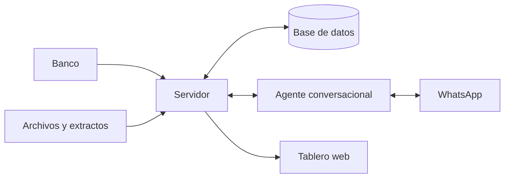

# Kairos Finanzas

Un agente conversacional que lleva los gastos de un hogar sin pedirle a nadie que abra una hoja de cálculo.

*Proyecto personal, de código privado. Este documento explica la idea y el enfoque.*

## El problema

Saber en qué se va el dinero de una casa suele exigir disciplina: anotar cada compra, categorizarla y cuadrarla a fin de mes. Casi nadie lo sostiene más de unas semanas.

La información ya existe, porque el banco avisa de cada compra. Lo que falta es alguien que la recoja, pregunte lo mínimo y la ordene.

## Qué hace

- **Registra las compras solo**, a partir de las notificaciones del banco.
- **Pregunta por WhatsApp solo cuando hace falta**: «¿De qué fue esta compra?», con opciones para responder en un toque.
- **Aprende** los comercios habituales, y deja de preguntar por ellos.
- **Concilia con el extracto** de la tarjeta para detectar lo que falta y evitar contar dos veces.
- **Revisa capturas o reportes** de la app del banco, dice qué compras no están registradas y las carga si se le autoriza.
- **Convierte compras en otra moneda** con la tasa oficial del día.
- **Muestra todo en un tablero web**: resumen, comparación entre meses y detalle editable.
- **Recuerda** lo pendiente, y envía un resumen diario y un repaso semanal.

Dos personas lo usan desde el chat que ya tienen abierto, en privado o en un grupo familiar.

## Cómo está pensado

La decisión central es separar **conversar** de **decidir**.

Un modelo de lenguaje es muy bueno entendiendo «la de ayer era del mercado». No es el lugar correcto para sumar dinero, decidir a quién escribirle o definir si una compra ya está registrada. Por eso:

- **El agente conversa y el servidor decide.** El modelo solo puede pedir acciones concretas y validadas.
- **Las cifras nunca salen del modelo.** Se calculan en la base de datos, y el agente publica el resultado.
- **Los documentos externos se tratan como datos, no como instrucciones.** Se leen en un paso aislado y su resultado se valida con reglas fijas antes de usarse.
- **Una autorización humana antes de las cargas masivas.**
- **Cada cambio deja rastro**, con el valor anterior y el nuevo.
- **Repetir una operación no la duplica.** Las redes fallan y los mensajes se reintentan; el sistema está construido para eso.

## Tecnología

| Parte | Tecnología |
|---|---|
| Web y API | TypeScript, Next.js |
| Base de datos | PostgreSQL |
| Agente | Claude y Model Context Protocol (MCP) sobre OpenClaw |
| Canal | WhatsApp |
| Pruebas | Más de 270 pruebas automáticas con datos sintéticos |

## Lo aprendido

- **La parte difícil no es la IA**, sino los casos de borde: reversos, cuotas, compras que aparecen en un corte y no en otro, mensajes que llegan dos veces.
- **Un agente útil tiene pocas libertades.** Cada capacidad que se le quita al modelo y se pasa a código hace al sistema más predecible.
- **Conciliar es más difícil que registrar.** Dos fuentes hablan de la misma compra con fechas y valores que no siempre coinciden.
- **La conversación debe costar poco.** Si responder toma más de unos segundos, la gente deja de hacerlo.
- **Probar con datos reales encuentra lo que las pruebas no ven.** Un archivo real expuso en minutos un problema que ninguna prueba había cubierto.

## Estado

En uso diario por un hogar. Es un proyecto vivo: se somete a revisiones técnicas y mantiene una lista abierta de mejoras.

El código y los datos son privados.
